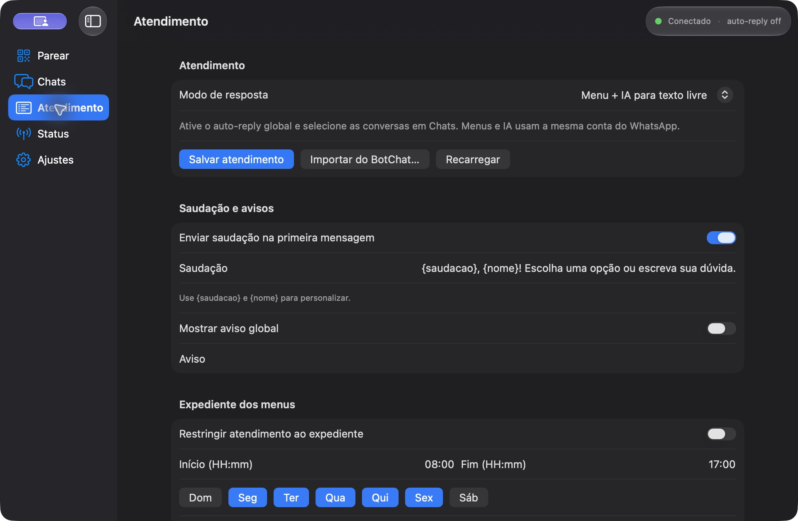
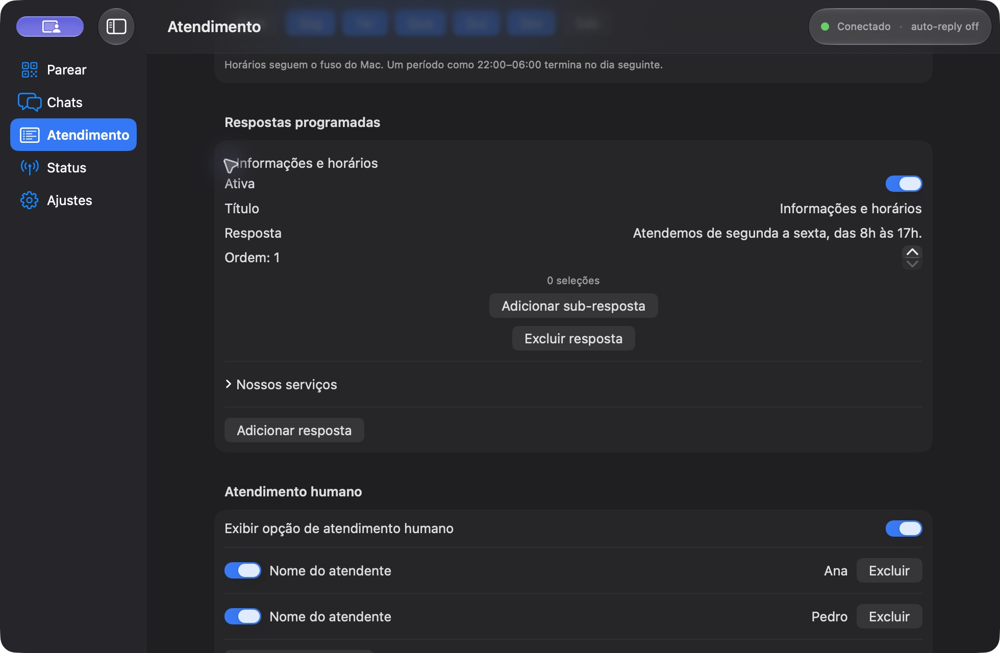
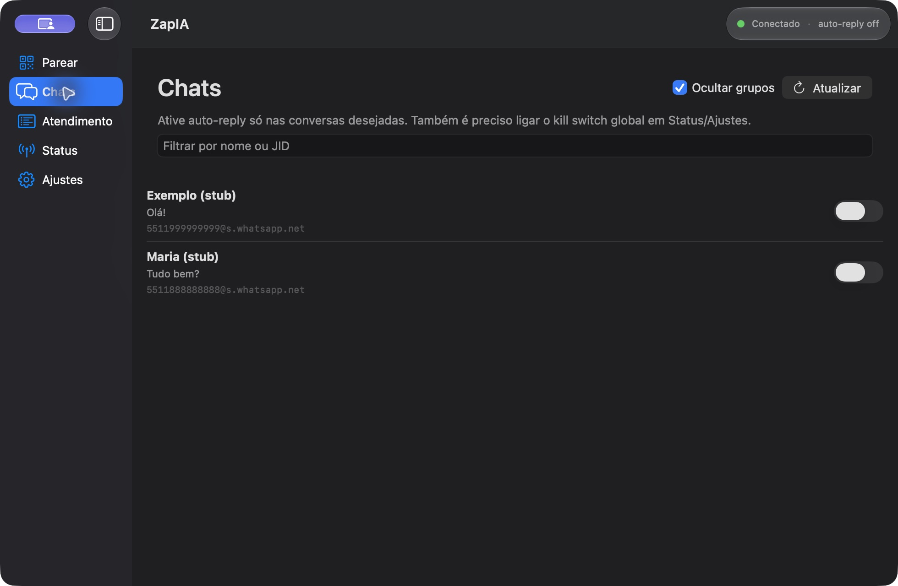

<p align="center">
  
</p>

# ZapIA

**WhatsApp com IA local, menus programados e atendimento humano em um único app para Mac.**

[**Baixar ZapIA 0.4.0 para Mac Apple Silicon (.dmg)**](https://github.com/mateusfrmacedo/ZapIA/releases/download/v0.4.0/ZapIA-apple-silicon.dmg) · [Versões e notas de lançamento](https://github.com/mateusfrmacedo/ZapIA/releases/latest)

Requer macOS 14+ e Apple Silicon (M1 ou superior). Node e bridge já estão incluídos.
O pacote usa assinatura ad-hoc e não tem notarização Apple.

App nativo **macOS** (Apple Silicon) que conecta sua conta WhatsApp pessoal via WhatsApp Web (Baileys), deixa você escolher em quais chats ativar auto-reply, e gera respostas **locais** em português com **Qwen/MLX** (Qwen2.5 4-bit) ou **Apple Intelligence** (Foundation Models).

> **Aviso:** o bridge usa cliente WhatsApp Web não oficial. Isso pode violar os Termos do WhatsApp/Meta e há risco de banimento da conta. Uso sob sua responsabilidade. Sem afiliação com Meta/WhatsApp. Inferência **não** usa APIs de LLM na nuvem.

## O aplicativo

Capturas reais do ZapIA em modo demonstração, com dados fictícios e WhatsApp simulado.

**Atendimento: modo híbrido, saudação e expediente**



**Respostas programadas e atendentes**



**Controle de auto-reply por conversa**



## ZapIA 0.4 — união dos projetos

O **ZapIA** reúne o app de IA local e os recursos de atendimento do antigo
**BotChat** em um único aplicativo nativo para **macOS**. Os históricos Git dos
dois projetos foram preservados. Repositório oficial:
[github.com/mateusfrmacedo/ZapIA](https://github.com/mateusfrmacedo/ZapIA).

Na seção **Atendimento**, escolha e salve um dos modos:

| Modo | Comportamento |
|---|---|
| Inteligência artificial | Respostas locais com Apple Intelligence ou Qwen/MLX |
| Menu programado | Saudação, avisos, respostas numeradas e submenus, sem usar IA |
| Menu + IA | Menu na primeira interação; IA para texto livre depois da saudação; `menu` ou `voltar` reabre as opções |

A tela permite cadastrar, editar, ativar e excluir respostas, sub-respostas e
atendentes; definir expediente por dia (incluindo virada da meia-noite), saudação
com `{saudacao}` e `{nome}`, aviso global e comunicados para até 30 contatos.
**Salvar atendimento** aplica as alterações. O expediente e a saudação se aplicam
aos modos de menu; as pausas de atendimento humano valem para todos os modos.

Todos os modos respeitam o **auto-reply global** e a seleção de **Chats**. Para
responder a alguém, selecione a conversa e ative o controle global. Mensagens de
sincronização anteriores à abertura do bridge não recebem resposta automática.

Ao selecionar atendimento humano, a conversa pausa até uma mensagem sua com
`!encerrar` no próprio WhatsApp. Uma mensagem manual sua pausa menus e IA por
30 minutos sem interação; novas mensagens do contato renovam o prazo. Essas
pausas sobrevivem ao reinício do app e a alterações de configuração.
Os comunicados exigem autorização dos contatos, mostram uma confirmação com o
texto e os destinatários, retornam falhas por número e pausam as respostas
automáticas dos destinatários. Eles não exigem selecionar os contatos em Chats.

### Migrar as instalações anteriores

- O nome do app, projeto Xcode, esquema, executável, pacote e instaladores agora é
  **ZapIA**. A configuração documentada usa o prefixo `ZAPIA_`.
- Preferências, histórico e pareamento da instalação anterior de IA são copiados
  para o novo nome no primeiro uso, preservando os arquivos originais. Feche o app
  antigo antes de abrir o ZapIA. Variáveis `IAZAP_*` antigas continuam aceitas para
  compatibilidade; as novas têm prioridade.
- Para trazer o atendimento do BotChat, abra **Atendimento → Importar do BotChat…**
  e selecione o `config.json` da instalação anterior (normalmente em
  `~/Library/Application Support/BotChat/`). Revise o resultado e clique em
  **Salvar atendimento**. O formato antigo `respostas.json` também é aceito.
  A importação substitui a configuração de atendimento atual apenas ao salvar.
- A sessão Chromium do BotChat não é compatível com Baileys: pareie novamente pelo
  QR do ZapIA. Os arquivos e a sessão antigos do BotChat permanecem intactos.
- Os dados novos ficam em `~/Library/Application Support/ZapIA/`: `data/atendimento.json`,
  `data/atendimento-state.json`, `data/messages.sqlite` e `baileys-auth/`.
- Esta unificação está focada no Mac. Os instaladores históricos Windows do BotChat
  continuam no repositório antigo; não são uma versão Windows do ZapIA.

## Começar (QR no app)

No Mac (Apple Silicon), a partir da raiz do repo:

```bash
git pull
./scripts/run-mac.sh
```

Ou só Xcode:

```bash
cd bridge && npm install && cd ..
open ZapIA/ZapIA.xcodeproj
```

1. Scheme **ZapIA** → destino **My Mac** → **Run** (▶).
2. Em **Parear**: aceite o aviso de risco ToS.
3. O app **inicia o bridge Node sozinho** (sem Terminal separado), escuta `$TMPDIR/zapia-bridge.sock` com `ZAPIA_TOKEN=dev-token-change-me`, e mostra o **QR grande** assim que o Baileys emitir `qr.update`.
4. No telefone: WhatsApp → Aparelhos conectados → Conectar um aparelho → escaneie.
5. Status vira **Conectado**; o QR desaparece.

Não precisa abrir outro Terminal para o bridge. Se o bridge já estiver rodando (`npm run serve`), o app só conecta no socket.

## App instalável (Apple Silicon)

Para gerar um `.dmg` (arrastar para Aplicativos) e um `.zip`:

```bash
./scripts/package-mac.sh
# Saída: dist-mac/ZapIA-apple-silicon.dmg e .zip
```

O pacote inclui Node e o bridge compilado com dependências de produção. O usuário
não precisa de Xcode, Node, npm ou do checkout para parear o WhatsApp. O bridge
usa os recursos do próprio app e grava seus logs em `ZAPIA_DATA/bridge.log`.
Requer macOS 14+ e Apple Silicon.

Esta versão de teste usa assinatura ad-hoc. Distribuição pública sem alertas do
Gatekeeper ainda exige um certificado **Developer ID Application** e notarização
Apple; esses passos não são executados pelo script. A inferência MLX e os pesos
continuam opcionais e exigem a configuração descrita abaixo. Sem o serviço,
o motor retorna mensagens de demonstração identificadas como stub.

### Verificação

```bash
cd bridge
npm ci
npm run build
npm test
npm run smoke:pipeline
cd ..
python3 -m unittest discover -s mlx-service -v
./scripts/smoke-bootstrap.sh
# Depois de empacotar:
./scripts/smoke-package.sh
```

O teste nativo usa WhatsApp simulado e diretórios temporários; não pareia contas.
O bridge conserva o QR mais recente e o reenvia após `session.hello`, inclusive
quando o cliente conecta depois da geração do código.

## Alternar Apple Intelligence e Qwen / MLX

Em **Ajustes → Inteligência artificial → Modelo**, escolha **Apple Intelligence
(local)** ou um modelo Qwen e clique em **Aplicar modelo**. A preferência é salva
para a próxima abertura. A troca cancela respostas antigas ainda em geração.

- **Apple Intelligence**: requer macOS 26+, Mac compatível e Apple Intelligence
  ativada/preparada nos Ajustes do Sistema. Usa Foundation Models no dispositivo,
  sem Python ou download de pesos pelo ZapIA. Indisponibilidade e recusas do modelo
  aparecem como erro; não há troca silenciosa para outro motor.
- **Qwen / MLX**: continua usando o serviço Python e os pesos configurados localmente.
  O modelo é carregado sob demanda, ou pelo botão **Carregar modelo**.

O helper nativo Apple é compilado pelo Xcode e incluído no app. Para usar o bridge
pelo Terminal, compile-o uma vez com `./scripts/build-apple-helper.sh`.
O app continua compatível com macOS 14+; em versões anteriores ao macOS 26,
a opção Apple informa que não está disponível.

Teste real dos dois motores, com WhatsApp sempre simulado (requer MLX e Apple prontos):

```bash
./scripts/build-apple-helper.sh
node scripts/smoke-engines.mjs
# Verifica também a preferência Apple no bootstrap nativo:
ZAPIA_TEST_APPLE=1 ./scripts/smoke-package.sh
```

## Prompt e recuperação de conexão

O preset [`prompts/conversa-natural.txt`](prompts/conversa-natural.txt) orienta o
estilo de conversa: curto, contextual e sem frases de atendimento. Cole-o no campo
Prompt dos Ajustes e aplique no bridge. Isso é configuração de comportamento,
não treinamento/fine-tuning dos pesos. O preset foi inspirado em ideias de estilo
[da reconstrução pública do prompt do Poke](https://gist.github.com/burritosoftware/dcde4ca404c825dced9421840eb8a497),
sem copiar identidade, ferramentas, integrações ou alegações daquele produto.

O bridge tenta recuperar falhas transitórias do WhatsApp com intervalos progressivos
(aproximadamente 2 a 30 segundos), preservando o pareamento. Mensagens já registradas
não recebem uma segunda resposta se forem reenviadas após reconexão. Uma sessão
revogada exige novo QR; conflito com outra cópia do app é mostrado como erro.

O app também recupera o IPC e reinicia seu processo filho se ele encerrar ou ficar
sem responder. Ao acordar do repouso, verifica a conexão novamente. Ajustar o prompt
ou recuperar o IPC com o mesmo modelo não descarrega os pesos MLX já preparados.
O Mac precisa estar acordado e com internet para receber/enviar mensagens.

Teste de queda do processo, sem usar WhatsApp real:

```bash
ZAPIA_TEST_RECOVERY=1 ./scripts/smoke-bootstrap.sh
# Simula um processo travado, sem usar WhatsApp real:
ZAPIA_TEST_HANG=1 ./scripts/smoke-bootstrap.sh
# Ou com o pacote e preferência Apple:
ZAPIA_TEST_RECOVERY=1 ZAPIA_TEST_APPLE=1 ./scripts/smoke-package.sh
```

## Mensagem única, ícone e estilo de conversa (0.2.2)

O app usa o novo ícone do gato piloto em todas as resoluções do macOS. O prompt
padrão agora descreve uma conversa casual e proíbe ofertas genéricas de ajuda,
como “Como posso ajudar hoje?”. O campo Prompt continua editável nos Ajustes.

As respostas não dependem de uma segunda mensagem: o intervalo de cooldown,
quando configurado, mantém a mensagem na fila e agenda a resposta automaticamente.
O padrão é **0 ms de cooldown**, mantendo **1 segundo de debounce** para agrupar
mensagens enviadas em sequência. Zero é preservado ao reabrir o app.

Mensagens recebidas durante um envio também ficam na fila. O kill switch cancela
a fila pendente. Frases convencionais de oferta de ajuda são removidas da resposta;
se toda a geração for apenas uma oferta genérica, há uma nova tentativa automática
no mesmo turno. Um segundo resultado genérico vira erro, sem enviar aquela frase.

A referência de estilo inclui os [prompts públicos atribuídos ao Poke](https://github.com/x1xhlol/system-prompts-and-models-of-ai-tools/tree/main/Poke),
sem copiar identidade, ferramentas ou alegações de capacidade. A naturalidade ainda
depende do modelo escolhido; essa configuração não treina seus pesos.

Validação local do estilo com mensagens fictícias e os dois motores, sem WhatsApp:

```bash
cd bridge
node --import tsx ../scripts/smoke-conversation.mts
```

## Perfil e prompt ativo (0.2.3)

Editar o campo Prompt aplica o texto automaticamente após uma pausa de 800 ms.
**Aplicar prompt agora** permite ativá-lo imediatamente. A indicação **Prompt ativo
nas próximas respostas** compara a impressão SHA-256 do texto com a configuração
que o bridge confirmou; texto salvo apenas no Mac não é apresentado como ativo.
Se estiver offline, o perfil é sincronizado ao reconectar.

O perfil atual prevalece sobre afirmações anteriores no histórico. Não é necessário
apagar a conversa para corrigir um nome antigo. Perguntas simples sobre o próprio
nome são respondidas usando o nome explicitamente configurado, sem o modelo adivinhar
outro nome ou inventar apelidos. Formatos reconhecidos incluem `Seu nome é Mateus`,
`Você se chama Mateus` e `Nome: Mateus`; nomes compostos também são aceitos.

Instruções explícitas como `Você não usa emoji nas conversas` prevalecem sobre o
estilo genérico. Nesse caso, emojis são removidos da resposta antes do envio,
inclusive se estiverem no histórico ou se o contato pedir para usá-los.
Outras preferências, como gostos e cor favorita, continuam orientando a geração
pelo modelo. A mensagem atual fica separada do contexto antigo e sempre é a última
entrada enviada ao modelo, mesmo quando timestamps do WhatsApp e de envios locais
colocariam a resposta anterior depois dela.

Testes reais com histórico fictício contraditório, sem enviar mensagens pelo WhatsApp:

```bash
./scripts/build-apple-helper.sh
cd bridge
node --import tsx ../scripts/smoke-persona.mts
```

## Status

| Camada | Estado |
|---|---|
| SwiftUI macOS (Parear QR in-app, auto-bridge, ToS, chats, status, modelo) | ✅ |
| Node bridge + Baileys + JSON-RPC (Unix socket) | ✅ |
| Pipeline (filtro, debounce, cooldown, contexto SQLite, send) | ✅ |
| `mlx-service` (Python + mlx-lm) + `ManagedReplyEngine` | ✅ Mac real / stub fallback |
| Protocolo compartilhado (`protocol/`) | ✅ v1 (+ pipeline + model) |
| App icon (Assets AppIcon) | ✅ |

Arquitetura: **SwiftUI + sidecar Node/Baileys (filho do app) + pipeline local + mlx-service (mlx-lm) on-device**.

## Layout do repositório

```
ZapIA/                 # App SwiftUI (Xcode)
bridge/                # Sidecar Node + Baileys + pipeline + MLX client
mlx-service/           # Helper HTTP local (mlx-lm) — Apple Silicon
protocol/              # JSON-RPC docs + types (TS; espelhado em Swift)
scripts/run-mac.sh     # npm install bridge + open/build/launch
```

## Requisitos (Mac M1 Pro)

- **Apple Silicon** (alvo: M1 Pro / 16GB+)
- **macOS 14+** recomendado
- **Xcode 15+**
- **Node.js 22.13+** (`node:sqlite` sem flag experimental)
- **Python 3.10+** com venv para `mlx-service` (Metal) — só para respostas MLX reais

### Memória (modelo)

| Modelo | Id | Nota M1 Pro 16GB |
|---|---|---|
| **Qwen2.5-7B Instruct 4-bit** (default) | `qwen2.5-7b-instruct-4bit` | Melhor PT-BR; feche apps pesados |
| Qwen2.5-3B Instruct 4-bit | `qwen2.5-3b-instruct-4bit` | Fallback se houver pressão de RAM |

## Fluxo depois do QR

1. Em **Chats**: ligue auto-reply só nos JIDs desejados.
2. Em **Ajustes / Status**: escolha o modelo, **Reload pesos**, ligue o kill switch global.
3. (Opcional) suba o `mlx-service` para respostas reais; sem ele o motor cai no stub PT-BR.
4. Receba texto num chat selecionado → debounce → MLX (ou stub) → envio via Baileys.

## MLX service (opcional na primeira conexão)

```bash
cd mlx-service
python3 -m venv .venv
source .venv/bin/activate
pip install -r requirements.txt
ZAPIA_MLX_AUTOLOAD=1 python server.py
# http://127.0.0.1:8742
```

Detalhes: [`mlx-service/README.md`](mlx-service/README.md).

## Bridge manual (só se quiser Terminal)

```bash
cd bridge
npm install
ZAPIA_TOKEN=dev-token-change-me npm run serve   # estável (sem watch)
# ou: npm run dev   # tsx watch
```

| Env | Default |
|---|---|
| `ZAPIA_SOCKET` | `$TMPDIR/zapia-bridge.sock` |
| `ZAPIA_TOKEN` | `dev-token-change-me` |
| `ZAPIA_AUTH` | `~/Library/Application Support/ZapIA/baileys-auth` |
| `ZAPIA_DATA` | `~/Library/Application Support/ZapIA/data` |
| `ZAPIA_BRIDGE_DIR` | resolvido pelo app (scheme / `bridge-root.txt` / pasta do repo) |
| `ZAPIA_STUB_WA` | unset |
| `ZAPIA_ENGINE` | `auto` (`mlx` \| `stub` \| `auto`) |
| `ZAPIA_MLX_URL` | `http://127.0.0.1:8742` |
| `ZAPIA_MLX_MODEL` | `qwen2.5-7b-instruct-4bit` |

**Logout** (`session.logout` / UI) apaga só `ZAPIA_AUTH`. Contexto SQLite fica em `ZAPIA_DATA`.

## Stub vs MLX

| | Stub | MLX |
|---|---|---|
| Quando | `ZAPIA_ENGINE=stub`, ou `auto` sem mlx-service | mlx-service up no Mac (Metal) |
| `engineId` | `stub` | `mlx:qwen2.5-…` |
| Qualidade | Placeholder PT-BR | Qwen2.5 instruct local |

## IPC

JSON-RPC 2.0, newline-delimited, Unix socket. Notificação `qr.update` alimenta o QR na tela Parear. Ver [`protocol/PROTOCOL.md`](protocol/PROTOCOL.md).

## Conexão única

O ZapIA usa **Baileys** para todos os recursos. O app gerencia o bridge como processo filho e mostra uma imagem QR grande até concluir o pareamento. Não execute uma instalação antiga em paralelo com a mesma sessão.

## Licença / uso

Projeto pessoal / experimental. Sem afiliação com Meta/WhatsApp.
